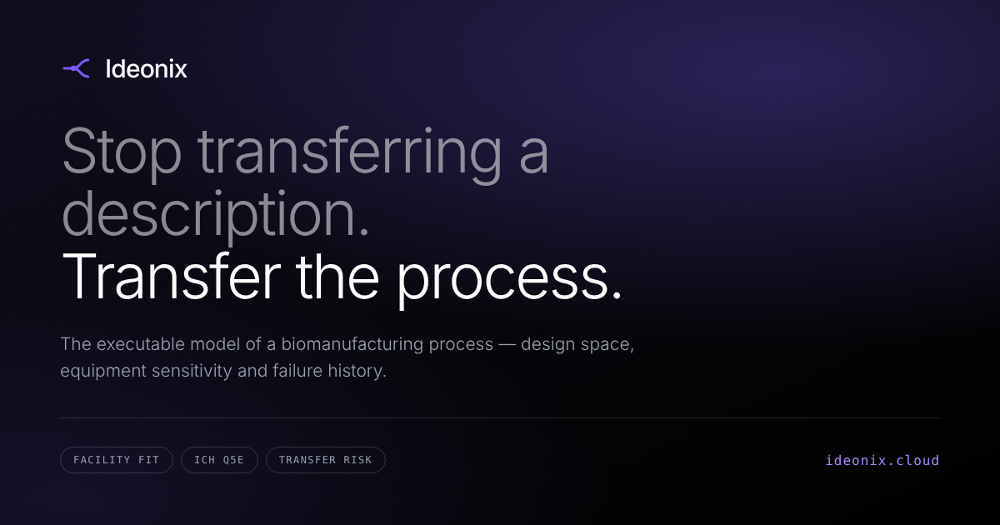

# Ideonix

**Stop transferring a description. Transfer the process.**

Ideonix builds the executable model of a biomanufacturing process — design space, equipment sensitivity and failure history — so the receiving site can interrogate it before the first GMP batch.

## Links

- **Website:** https://ideonix.cloud
- **Contact:** founder@ideonix.cloud
- **Founder & CEO:** [Shriman Maheshwari](https://www.linkedin.com/in/shriman-maheshwari/)

## What this repository contains

The Ideonix marketing site: one self-contained `index.html` with inline CSS and JavaScript, no framework and no build step, plus a matching `404.html` and the usual static assets. Deployed on GitHub Pages at the custom domain in `CNAME`.

| File | Purpose |
| --- | --- |
| `index.html` | The site. Inline CSS/JS, JSON-LD structured data, full Open Graph set. |
| `404.html` | Not-found page in the same design. |
| `og-image.png` | 1200×630 social preview card. |
| `favicon.svg`, `favicon-32.png` | Browser icons. |
| `apple-touch-icon.png` | 180×180 iOS home-screen icon. |
| `icon-192.png`, `icon-512.png` | Progressive web app icons. |
| `site.webmanifest` | Web app manifest. |
| `robots.txt` | Crawler rules, with the sitemap reference. |
| `sitemap.xml` | XML sitemap including the preview image. |
| `llms.txt` | Plain-language summary for AI search and answer engines. |
| `humans.txt` | Credits. |
| `.well-known/security.txt` | Security contact. |
| `CNAME` | Custom domain for GitHub Pages. |
| `.nojekyll` | Stops GitHub Pages running the files through Jekyll. |

## Deploying

1. Push these files to the repository root on the default branch.
2. In **Settings → Pages**, set the source to that branch and the `/` root folder.
3. Point DNS at GitHub Pages: four `A` records for the apex domain to `185.199.108.153`, `185.199.109.153`, `185.199.110.153` and `185.199.111.153`, plus a `CNAME` record for `www` pointing at `<username>.github.io`.
4. Once the domain resolves, tick **Enforce HTTPS** in the Pages settings.

## Notes

The hero and card photographs are hotlinked from Unsplash. Download them and serve them from this repository before treating the site as production, so the page does not depend on a third-party host.

Every product screenshot, panel reading, batch number and figure shown on the site is illustrative and labelled as such. They are design examples of the product's output, not customer results or traction. The two industry statistics on the page each cite their source inline.
